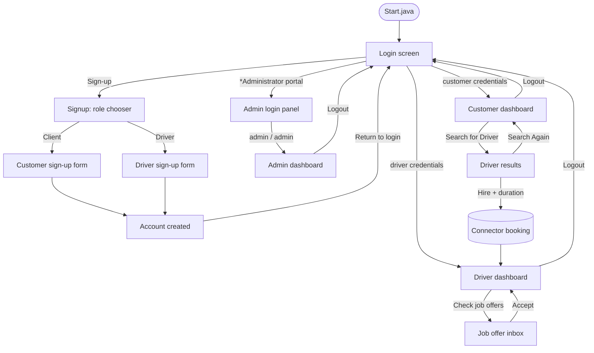
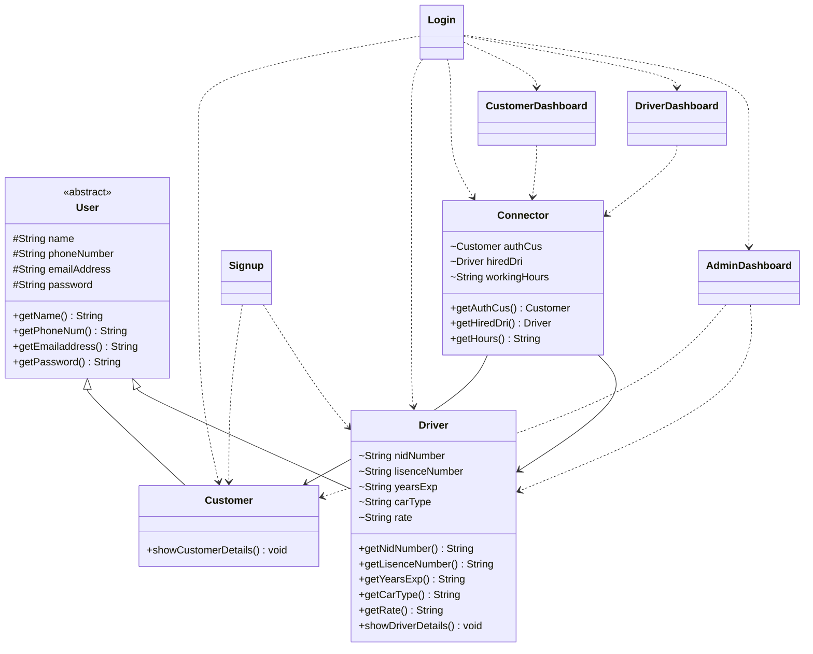

# Driver Chai 1.0

<p align="center">
  
</p>

<p align="center">
  <strong>A desktop driver-hiring marketplace built from scratch with Java Swing and object-oriented design.</strong>
</p>

<p align="center">
  
  
  
  
  
</p>

<p align="center">
  
</p>

> **“Driver চাই?”** (transliterated *Driver Chai*) is Bengali for **“Need a driver?”**  
> The project is a desktop marketplace where a car owner can find, compare, and hire a verified driver for a chosen number of hours, while drivers receive job offers and administrators manage the platform.

---

## Table of contents

- [Project at a glance](#project-at-a-glance)
- [The problem and the idea](#the-problem-and-the-idea)
- [Feature tour by role](#feature-tour-by-role)
- [Screen flow](#screen-flow)
- [Architecture](#architecture)
- [Object-oriented design in practice](#object-oriented-design-in-practice)
- [How the application was hand-coded](#how-the-application-was-hand-coded)
- [Engineering challenges and creative solutions](#engineering-challenges-and-creative-solutions)
- [End-to-end booking flow](#end-to-end-booking-flow)
- [Data and persistence](#data-and-persistence)
- [Running the project](#running-the-project)
- [Codebase metrics](#codebase-metrics)
- [What this project demonstrates](#what-this-project-demonstrates)
- [Known limitations and v1.1 roadmap](#known-limitations-and-v11-roadmap)
- [Repository notes](#repository-notes)
- [Author](#author)

---

## Project at a glance

| | |
|---|---|
| **Application type** | Desktop driver-hiring marketplace |
| **Language** | Java (JDK 8 compatible) |
| **GUI toolkit** | Java Swing / AWT |
| **Architecture** | Package-by-feature: domain, authentication, role workflows |
| **Data model** | Plain Java objects held in fixed-capacity arrays, linked by a booking association class |
| **Persistence** | Append-only plain-text records in `Data/` |
| **External dependencies** | **None** — JDK only |
| **UI designer / GUI builder** | **None** — every component is declared and positioned in source code |
| **Entry point** | `Start.java` |
| **Roles** | Customer, Driver, Administrator |
| **Build sources** | 10 Java files, **2,191 lines** |
| **Retired drafts** | 2 Java files, 373 lines (kept for history, excluded from the build) |
| **Admin credentials** | `admin` / `admin` (deliberately simple for demo) |

The application is intentionally **self-contained**. There is no Maven/Gradle build, no database driver, no ORM, no third-party UI library, and no generated code. Copying the folder onto a machine with a JDK is enough to compile and run it.

---

## The problem and the idea

Ride-hailing apps solve "I need a car with a driver." This project solves a different, common problem:

> **"I already have a car, but I need a trustworthy driver for a few hours."**

That distinction shaped the whole design:

- A **Customer** does not book a trip from A to B. They hire a **driver**, for their own car, for a selected duration.
- A **Driver** is a service provider with a license, national ID, experience band, preferred vehicle type, and hourly rate.
- An **Administrator** needs to see and manage both populations.

The result is a three-sided desktop application with registration, authentication, filtered search, booking, job offers, and admin controls — implemented with core Java and Swing.

### Why the name matters

“Driver Chai” is not a tea shop. It is the Bengali phrase **“ড্রাইভার চাই?”** — *“Need a driver?”* The login artwork, logo, and copy use that local voice, which makes the project feel like a real product rather than a generic CRUD exercise.

---

## Feature tour by role

### Customer

| Feature | Implementation |
|---|---|
| Create an account | Dedicated customer form with name, phone, email, password, and confirm password |
| Validate input | Minimum-length checks plus password equality before an account is created |
| Log in | Name/password lookup against the customer collection |
| Search for a driver | Filter by **vehicle type** and **years of experience** |
| Browse results | Result cards are generated at runtime, one per matching driver |
| Choose duration | Each result card has its own duration selector (2–10 hours) |
| Hire a driver | Creates a `Connector` booking object linking the logged-in customer, selected driver, and duration |
| See feedback | Modal success/warning dialogs for confirmation and invalid credentials |
| Log out / exit | Return to login or terminate the application |

### Driver

| Feature | Implementation |
|---|---|
| Create an account | Driver form adds NID number, license number, experience, vehicle type, and hourly rate |
| Log in | Name/password lookup against the driver collection |
| Check job offers | Renders one card per booking in the shared connector collection |
| Inspect an offer | Card shows customer name, phone number, and hiring duration |
| Accept a job | Per-card **Accept** button with a success dialog |
| Log out / exit | Return to login or terminate the application |

### Administrator

| Feature | Implementation |
|---|---|
| Reach the portal | Hidden `*Administrator portal` entry on the login screen |
| Authenticate | Hard-coded demo credential gate (`admin` / `admin`) |
| View customers | Dynamically generated list with name, phone, email, and password |
| View drivers | Dynamically generated list with the same account fields |
| Remove a user | Delete by username, rebuild the list in place |
| Log out / exit | Return to login or terminate the application |

### Platform-wide

- Consistent visual identity across every screen.
- Reusable background artwork and a custom logo.
- Centered 1100 × 700 frames that behave like a single application.
- Console diagnostics during development (`System.out.println`) for account and booking events.
- Registration records appended to disk so account creation leaves a durable trail.

---

## Screen flow



Each class owns one frame and switches between its own sibling panels with `setVisible(false)` / `setVisible(true)`. There are **15+ panel states** across the application and **no window is recreated just to change a view**.

---

## Architecture

### Package structure

```text
Driver-chai-1.0/
├── Start.java                      # Entry point: creates the shared collections, opens Login
├── User/
│   ├── User.java                   # Abstract base class: identity + credentials
│   ├── Customer.java               # Customer specialization
│   └── Driver.java                 # Driver specialization + professional attributes
├── Login/
│   ├── Login.java                  # Role routing, credential checks, admin portal
│   ├── Signup.java                 # Unified four-panel registration flow
│   ├── CustomerSignUp.java         # Retired first-pass prototype (not built)
│   └── DriverSignUp.java           # Retired first-pass prototype (not built)
├── Dashboard/
│   ├── CustomerDashboard.java      # Search, filter, result cards, hiring
│   ├── DriverDashboard.java        # Job-offer inbox and acceptance
│   ├── AdminDashboard.java         # Customer/driver management and deletion
│   └── Connector.java              # Booking association: customer + driver + hours
├── Data/
│   ├── customers.txt               # Append-only registration records
│   └── drivers.txt                 # Append-only registration records
├── Images/
│   ├── Background2.jpg             # Login artwork
│   ├── logo.png                    # Application icon/logo
│   └── 1.png … 8.png               # Reusable screen backgrounds
└── README.md
```

### Class relationships



### Design approach

The code follows a **package-by-feature** split rather than a strict MVC split:

- **`User`** is the domain layer. It contains identity and credential logic, with no UI behavior.
- **`Login`** is the authentication and routing layer. It owns the session collections and decides which dashboard opens.
- **`Dashboard`** contains the three role workflows plus the `Connector` association entity.
- **`Start`** is a deliberately tiny composition root: it creates the initial collections and opens the first screen.

The most important architectural decision is that **the object graph is the database**. `Start` seeds three arrays, then the login screen and all three dashboards receive the relevant arrays through their constructors. No screen reaches into global/static state. That makes the flow of data explicit and keeps the classes independently testable by inspection. The one exception is `Signup`, which currently owns local account arrays; that gap is documented in [Known limitations](#known-limitations-and-v11-roadmap).

---

## Object-oriented design in practice

| Concept | Where it appears | Why it matters |
|---|---|---|
| **Abstraction** | `User` declares four abstract getters | Every screen can treat a customer or driver as a `User` without knowing the subtype |
| **Inheritance** | `Customer extends User`, `Driver extends User` | Shared identity and credential fields are defined once |
| **Encapsulation** | `protected` fields in `User`; controlled access through getters | State is not exposed through public fields, and subclasses reuse the base representation |
| **Polymorphism** | Login calls the overridden getters on either subtype through the shared `User` contract | The same lookup logic works for both roles |
| **Composition / association** | `Connector` holds a `Customer`, a `Driver`, and `workingHours` | A booking is modeled as a first-class relationship instead of polluting `Customer` or `Driver` with booking fields |
| **Constructor chaining** | `super(name, phone, email, password)` in both subclasses | Guarantees the base invariants run before subclass initialization |
| **Interface implementation** | `ActionListener` implemented by five controller classes | Swing events are centralized per screen instead of scattered anonymous listeners |
| **Dependency injection** | Collections and the authenticated customer are passed through constructors | No hidden global state; dependencies are visible in every signature |
| **Object identity** | The authenticated `Customer` instance is passed to the dashboard and stored in each booking | The booking points to the same live object, not a copied row |
| **Exception handling** | `try/catch` around signup file writes | A disk failure cannot crash the registration flow |
| **Defensive validation** | Length checks and password confirmation before object creation | Invalid accounts never enter the collection |
| **Separation of concerns** | Domain classes contain no UI behavior; UI classes own the presentation logic | Each layer has a single reason to change |

A subtle but important detail: `Customer` and `Driver` do **not** expose setters. Once an account is created, its identity is immutable from the UI's perspective. Mutation happens only at the collection level (insert/remove), which keeps the model predictable.

---

## How the application was hand-coded

This project was built **without a GUI designer, without generated `initComponents()` methods, and without any third-party library**. Every frame, panel, label, field, combo box, and button exists because it was declared, configured, and added in Java source.

### The manual workflow

1. **Sketch the screen as a 1100 × 700 canvas.** Every panel uses `setLayout(null)` and explicit `setBounds(...)` coordinates.
2. **Create the components as named fields.** Keeping them class-scoped is what allows `actionPerformed` to compare `e.getSource()` against the right button later.
3. **Build the visual hierarchy.** Background artwork is added after the interactive components so it occupies the back layer. Labels, fields, and buttons are layered above it.
4. **Style each control.** Fonts are derived from the platform default with `deriveFont`, fields get a one-pixel matte bottom border, and buttons use a black/white palette.
5. **Attach one listener per screen.** Each controller implements `ActionListener` and routes events with `if (e.getSource() == ...)`.
6. **Add the panel to the frame.** Sibling panels overlap in the same frame and are toggled with visibility flags.
7. **Compile, run, inspect, adjust coordinates.** The layout was tuned by repeatedly launching the app and correcting bounds — the classic manual Swing workflow.

### The visual system

| Token | Value used in code |
|---|---|
| Canvas | `1100 × 700`, centered with `setLocationRelativeTo(null)` |
| Primary button | Black fill, white text, `150 × 50` (small actions vary) |
| Text input | Transparent field, `1px` black bottom border |
| Highlight card | `new Color(244, 200, 85)`, `580 × 100` |
| List rhythm | `110px` vertical pitch between generated cards |
| Background | Full-bleed artwork added last in each panel |
| Type scale | `18f`, `20f`, `23f`, `30f` derived fonts |
| Palette | Black, white, gray panel base, warm amber artwork |

### Recurring implementation techniques

**Underline text fields that sit directly on artwork**

```java
tf1.setBorder(BorderFactory.createMatteBorder(0, 0, 1, 0, Color.BLACK));
tf1.setFont(midFont);
tf1.setOpaque(false);
```

`setOpaque(false)` lets the background image show through the field, while the matte border supplies the underline. This is a small detail, but it is what makes the forms look designed rather than like default Swing controls.

**Fonts derived from the platform default**

```java
Font bigFont = l14.getFont().deriveFont(Font.PLAIN, 30f);
```

Rather than hard-coding a font family, the app scales the runtime default. It therefore respects the operating system's font while keeping a consistent type hierarchy.

**One frame, multiple panels**

```java
loginDashboard.setVisible(false);
adminLogin.setVisible(true);
```

This avoids opening a new window for every state change. The frame stays in place, the title bar does not flicker, and the transition is instantaneous.

**Section banners inside long constructors**

```java
/////////// Customer Panel /////////////////
```

Large Swing constructors are hard to scan. The banners act as visual anchors and make the panel boundaries obvious when navigating a 350–500 line class.

**Explicit teardown before reconstruction**

```java
adminPanel3.removeAll();
```

Generated cards are detached before the list is rebuilt, preventing stale rows from stacking on top of new ones.

---

## Engineering challenges and creative solutions

The interesting part of this project is not that it uses arrays or Swing. It is **how the constraints were turned into workable designs**.

| # | Challenge | Constraint | Creative solution | Result |
|---|---|---|---|---|
| 1 | Share live data across screens | No database, no ORM, no globals | Pass the same arrays and authenticated object through constructors | Every dashboard observes the same object graph |
| 2 | Model a hire without polluting the domain classes | `Customer` and `Driver` should stay clean | Introduce `Connector` as a booking association entity | One object captures customer + driver + duration |
| 3 | Render a variable number of results | No table model, no recycler, no layout library | Generate a `JPanel` card per result with a fixed 110px pitch | A hand-rolled list view built from primitives |
| 4 | Route events from buttons that do not exist at compile time | Buttons are created inside a loop/factory | Store each card's button in a parallel array at the same index as its data | Correct row-to-action mapping without lambdas or captured state |
| 5 | Put a full-bleed image behind interactive controls | No `JLayeredPane`, null layout only | Add the image `JLabel` **last** and exploit Swing's reverse child painting order | Artwork fills the screen with controls still clickable |
| 6 | Rebuild admin lists after deletion | Panels retain old children | `removeAll()` + visibility pulse + regenerate from the model | List reflects the deletion immediately |
| 7 | Separate customer, driver, and admin entry points | One login screen, one frame | Two sibling login panels toggled by a hidden admin button; role lookup after login | Clean role routing without extra windows |
| 8 | Persist accounts without JDBC | JDK-only rule | Append-only `PrintWriter` records with auto-created files | Registration history persists on disk |
| 9 | Make default Swing controls look branded | No custom Look-and-Feel, no image-based widgets | Transparent fields, matte borders, derived fonts, curated palette | A coherent visual identity built from standard components |
| 10 | Keep state consistent when navigating back and forth | Screens are long-lived objects | Explicit `setVisible` transitions and `removeAll()` rebuilds | No duplicated cards or stale login state |

### 1. Shared state without a database

The session collections are created once in `Start` and injected into `Login`:

```java
Customer[] blankc  = new Customer[1];
Driver[]   blankd  = new Driver[100];
Connector[] blankcon = new Connector[1];

new Login(blankc, blankd, blankcon);
```

`Login` then forwards the same references to whichever dashboard authenticates:

```java
new CustomerDashboard(customers, drivers, authCus, connectors);
```

Because Java passes object references by value, every dashboard sees the same array and the same `Customer` instance. A booking added in `CustomerDashboard` is immediately visible to any `DriverDashboard` constructed with that connector array. **There is no serialization boundary and no cache to invalidate.**

### 2. A booking is a relationship, not a field

Instead of adding `hiredDriver` to `Customer` and `hiredCustomer` to `Driver` (which would create a tangled bidirectional model), the project introduces:

```java
public class Connector {
    Customer authCus;
    Driver hiredDri;
    String workingHours;
}
```

This is the cleanest object-oriented decision in the codebase. It keeps both domain classes focused on identity and professional attributes, and it gives the driver dashboard exactly what it needs to render an offer: who hired me, how to contact them, and for how long.

### 3. Dynamic result cards without a table widget

`CustomerDashboard.filter()` walks the driver collection and appends matches:

```java
if (type.equals(driType) && exp.equals(driExp)) {
    addResult(drivers[i]);
}
```

`newGIG()` then turns each match into a card. The vertical position is derived from the row index, so the cards stack predictably:

```java
int posY = gap * 110;
resultsp.setBounds(10, 10 + posY, 580, 100);
```

Each card contains a name label, experience, hourly rate, a duration combo box, and a **Hire** button. The same factory pattern is reused for job offers (`jobListings`) and for the admin lists (`cusList`, `driList`). This is effectively a **hand-built view factory** — no `JTable`, no `DefaultTableModel`, no external list control.

### 4. Routing events from runtime-generated buttons

The hard part of dynamic UI is not drawing the card; it is knowing **which row's button fired**. The project solves that with index-aligned parallel arrays:

```java
public void newGIG(Driver searchResult, int gap) {
    // ...
    hireDriver[gap]  = bHireDriver;
    serviceHour[gap] = dServiceHour;
}
```

```java
for (int i = 0; i < hireDriver.length; i++) {
    if (e.getSource() == hireDriver[i]) {
        Driver hiredDri = searchResult[i];
        String hourss = serviceHour[i].getSelectedItem().toString();
        // ...
    }
}
```

The row index is the join key between three arrays: the result data, the button, and the duration selector. It is a compact, dependency-free form of view-model binding. The trade-off is an O(n) scan per click, which is irrelevant at the project's scale (≤ 100 rows) and is easy to reason about.

### 5. Background artwork without a layered pane

This is the most enjoyable Swing-specific trick in the project. Every panel adds its full-size image label **after** the interactive components:

```java
loginDashboard.add(b1);
loginDashboard.add(b2);
loginDashboard.add(l1);
loginDashboard.add(tf1);
loginDashboard.add(p1);
loginDashboard.add(background); // added last, painted first
loginDashboard.setLayout(null);
```

Swing paints a container's children from the highest index down to index `0`. The last-added component has the highest index, so it is painted first and ends up at the **back**. The earlier components are painted afterward and therefore appear on top. Adding the image last is what produces a full-bleed background without a `JLayeredPane`, a custom `paintComponent`, or a layered container.

### 6. Rebuilding views safely

When the administrator removes a customer, the model changes and the view must be regenerated:

```java
customers[i] = null;
adminPanel3.removeAll();
adminPanel2.setVisible(false);
adminPanel2.setVisible(true);

for (int i = 0; i < customers.length; i++) {
    if (customers[i] != null) {
        cusList(customers[i], i);
    }
}
```

`removeAll()` clears the old cards, the visibility pulse forces the container to revalidate and repaint, and the loop reconstructs the list from the authoritative array. The same pattern is used for driver management and for clearing search results before a new query.

### 7. Validation and feedback without a form framework

The signup flow checks the essentials before constructing a domain object:

```java
if (dname.length() >= 3 && dphoneNo.length() >= 3 && demail.length() >= 3
        && dnid.length() >= 3 && dlicense.length() >= 3
        && drate.length() >= 1 && dpass.equals(dconfPass)) {
    Driver d = new Driver(dname, dphoneNo, demail, dpass,
                          dnid, dlicense, dexp, dtype, drate);
}
```

Login failures and successful hires use `JOptionPane` dialogs, giving immediate modal feedback without building a notification system.

### 8. Persistence with the standard library only

Registration appends a three-line record to a text file:

```java
File file = new File(".\\Data\\customers.txt");
if (!file.exists()) {
    file.createNewFile();
}

PrintWriter pw = new PrintWriter(
    new BufferedWriter(new FileWriter(file, true)));

pw.println("User Name : " + cname);
pw.println("Password : " + cpass);
pw.println("Phone : " + cphoneNo);
pw.close();
```

The `true` flag opens the writer in append mode, and the existence check makes the first run self-initializing. No schema, no connection string, no migration. For an academic desktop app this is a deliberate trade-off: minimal setup and a human-readable artifact.

### 9. Keeping the screen hierarchy consistent

Each dashboard is a small state machine:

- Customer: search form → results → search again.
- Driver: home → job offers → back.
- Admin: home → customers/drivers → back.

Every transition hides one panel and shows another. Because all panels share a `null` layout and the same frame size, the visual result is a single window that changes content, not a stack of unrelated dialogs.

---

## End-to-end booking flow

This is the designed flow the architecture supports:

1. `Start` creates empty customer, driver, and connector collections.
2. A customer registers through `Signup`. A `Customer` object is constructed, appended to the in-memory collection, and written to `Data/customers.txt`.
3. The return button constructs a fresh `Login` with the same collections.
4. The customer authenticates. `Login` finds the object by name and password, then opens `CustomerDashboard` with the authenticated customer and the shared arrays.
5. The customer selects a vehicle type and experience band.
6. `filter()` scans the driver array and calls `addResult()` for each match.
7. `newGIG()` renders one card per match, with its own duration selector and Hire button.
8. The customer chooses a duration and clicks **Hire**.
9. The handler resolves the row index, finds the first free slot in the connector array, and creates a `Connector(customer, driver, hours)`.
10. Logging out returns to login.
11. The driver authenticates. `DriverDashboard` receives the same connector array.
12. **Check your job offers** renders each connector as a card with customer name, phone, and duration.
13. **Accept** confirms the job with a dialog.

The crucial point is step 9: the booking captures **references** to the live customer and driver objects, so no name matching or re-querying is needed when the offer is displayed.

> **Demo note:** the booking inbox is fully wired to the shared `Connector[]`, but the current `Signup` controller keeps its own local account arrays (see [Known limitations](#known-limitations-and-v11-roadmap)). To see a populated driver inbox in a single run, the customer and driver accounts must already be present in the same session collections. The model and dashboards are ready for that; the signup wiring is the one remaining gap.

---

## Data and persistence

### Record format

`Data/customers.txt` and `Data/drivers.txt` use a simple line-oriented format:

```text
User Name : <name>
Password : <password>
Phone : <phone>
```

Each registration appends three lines. The files are created automatically if missing. Note that both files use the same three fields; driver-specific attributes such as NID, license, experience, vehicle type, and rate are held only in memory.

### What the files are — and are not

- **They are** an append-only registration trail and evidence of manual testing.
- **They are not** loaded back into the application at startup. The runtime model is in-memory; the files are a write-only audit log in v1.0.

This distinction is deliberate and documented rather than hidden. Adding a parser and hydrating the arrays on startup is the first item in the roadmap.

### In-memory capacities

| Collection | Capacity at startup | Notes |
|---|---|---|
| `Customer[]` | 1 in `Start`, 100 after a signup session | The startup array is intentionally minimal; signup allocates 100 |
| `Driver[]` | 100 | Fixed capacity, first-null insertion |
| `Connector[]` | 1 | Only one booking slot is seeded in v1.0 |

The arrays are fixed-capacity stores with **first-free-slot insertion**, not dynamic collections. This keeps the data layer dependency-free and makes insertion behavior explicit. The trade-off is a hard ceiling and a silent no-op when full; both are called out in the roadmap.

---

## Running the project

### Requirements

- **JDK 8 or newer** (the source uses only standard Java SE APIs).
- A desktop environment capable of rendering Swing windows.
- Write permission for the `Data/` folder (only needed when creating accounts).

### Compile and run

From the **repository root** (important: image paths are relative):

```bash
javac Start.java
java Start
```

`javac` resolves the imported package sources from the current directory. If your setup prefers an explicit source list, use:

```bash
javac Start.java User/User.java User/Customer.java User/Driver.java Login/Login.java Login/Signup.java Dashboard/Connector.java Dashboard/CustomerDashboard.java Dashboard/DriverDashboard.java Dashboard/AdminDashboard.java
java Start
```

> **Do not compile `Login/*.java` with a wildcard.** The two retired prototype files are intentionally outside the build (one still imports a prototype-only package), so the explicit source list above is the safe option.

The repository includes compiled `.class` files from the original build. If your JDK version differs, recompile with the command above before running.

### If launched from an IDE

Set the **working directory to the repository root**. The code loads artwork with paths such as `Images/Background2.jpg`; running from a different directory will produce blank panels or missing icons.

### Administrator access

1. Launch the app.
2. Click **`*Administrator portal`** at the bottom-left of the login screen.
3. Enter:
   - Username: `admin`
   - Password: `admin`
4. Use **Manage Customers** or **Manage Drivers** to inspect the current session collections.

The admin credential is intentionally hard-coded for the demo. It is not a security feature and is documented as such.

### First-run behavior

- The `Data/` folder already contains sample records from development.
- New registrations append to those files.
- The initial login screen starts with an empty customer array, so create an account through **Sign-up** before attempting a customer login.
- The application prints development diagnostics to the console; this is expected.

---

## Codebase metrics

| File | Lines | Responsibility |
|---|---:|---|
| `Start.java` | 20 | Composition root; seeds collections and opens login |
| `User/User.java` | 30 | Abstract identity/credential base class |
| `User/Customer.java` | 53 | Customer specialization |
| `User/Driver.java` | 97 | Driver specialization and professional attributes |
| `Login/Login.java` | 341 | Login panels, credential lookup, role routing, admin gate |
| `Login/Signup.java` | 511 | Four-panel registration flow and file persistence |
| `Dashboard/Connector.java` | 46 | Booking association entity |
| `Dashboard/CustomerDashboard.java` | 355 | Search, filtering, dynamic result cards, hiring |
| `Dashboard/DriverDashboard.java` | 261 | Job-offer inbox and acceptance |
| `Dashboard/AdminDashboard.java` | 477 | Customer/driver lists and deletion |
| **Total build sources** | **2,191** | **10 files** |
| `Login/CustomerSignUp.java` | 171 | Retired prototype, not built |
| `Login/DriverSignUp.java` | 202 | Retired prototype, not built |

Additional facts:

- **5 controller classes** implement `ActionListener`.
- **150+ Swing components** are instantiated and positioned manually.
- **0 external dependencies**, **0 generated UI files**.
- **4 registration panels** (role chooser, customer form, driver form, success screen), **3 dashboards**, **2 login panels**.
- The project history shows an incremental build: dashboard work, login fixes, and a driver dashboard added in successive commits.

### Why there are retired prototype files

`CustomerSignUp.java` and `DriverSignUp.java` are the first-pass design: one window per signup role, with duplicated layout code. They were later replaced by a single `Signup` controller that owns all four panels in one frame. They remain in the repository as a record of that refactor, but they are not referenced by `Start` and are excluded from the build. The final application does not depend on them.

---

## What this project demonstrates

### Technical depth

- Designing a multi-screen desktop application with a coherent navigation model.
- Applying abstraction, inheritance, polymorphism, encapsulation, association, and constructor injection in a real workflow.
- Building dynamic UI from primitives: runtime card factories, index-aligned event routing, and rebuild-on-mutation lists.
- Working directly with Swing's painting order and layout behavior instead of hiding behind a designer.
- Using file I/O, validation, modal feedback, and exception handling in a complete feature flow.
- Keeping a dependency-free codebase organized across packages and roles.

### Engineering judgment

- Recognizing that a booking is a **relationship object**, not a pair of fields.
- Choosing explicit constructor injection over static/global state.
- Making the in-memory object graph the single source of truth.
- Documenting trade-offs and limitations instead of presenting the project as more than it is.
- Refactoring duplicated signup windows into one controller.
- Keeping the composition root (`Start`) minimal.

### Product thinking

- A local, culturally specific brand (“Driver চাই?”) rather than a generic title.
- Three distinct user journeys with role-appropriate language.
- A consistent visual system across every screen.
- Immediate feedback for success and failure states.
- A workflow that matches the real problem: hiring a driver for your own car, not booking a taxi ride.

---

## Known limitations and v1.1 roadmap

The current version is a complete academic prototype, not a production system. The following boundaries are known and intentional:

| Area | Current v1.0 behavior | Planned improvement |
|---|---|---|
| Signup/session wiring | `Signup` owns local account arrays, so accounts created in one signup session do not merge with a previous session's collections | Pass the session arrays into `Signup` and insert into them; this is the single change needed for a full cross-role demo in one run |
| Startup hydration | `Data/*.txt` is written but not read at startup | Add a parser and hydrate the collections before opening `Login` |
| Booking capacity | `Start` seeds a one-element connector array | Size the booking store independently or use a growable collection |
| Job visibility | Every driver sees every booking in the inbox | Filter offers by `connector.getHiredDri()` identity and persist acceptance status |
| Admin deletion | Removes from memory only | Rewrite the corresponding data file with an atomic temp-file swap |
| Account security | Passwords are plaintext in memory, in the UI, and in files; admin credentials are hard-coded | Hash passwords, add a role field and unique account IDs, and move the admin secret out of source |
| Result scrolling | Result panels have a fixed 500px viewport; more than four cards overflow | Wrap generated lists in a `JScrollPane` or move to `JTable` |
| Collections | Fixed arrays with silent failures when full | `ArrayList`/`HashMap` with explicit capacity handling |
| Layout | Absolute positioning at a fixed 1100 × 700 size | `GridBagLayout` or a responsive layout; test at different screen sizes and DPI settings |
| Threading | UI is constructed on the main thread | Wrap startup in `SwingUtilities.invokeLater` and keep all Swing work on the EDT |
| Build hygiene | Compiled `.class` files are committed; `Images/1.png`–`8.png` are identical copies | Add `.gitignore`, remove build artifacts, collapse duplicate assets |
| Testing | Manual verification through the UI and data-file inspection | Add JUnit tests for model invariants, filtering, and credential lookup |

Being explicit about these boundaries is part of the engineering work. The architecture already isolates most of the fixes to a single class or constructor signature, which is a sign that the original decomposition was sound.

---

## Repository notes

- **Remote:** [github.com/sk-asifnewaz/Driver-chai-1.0-Java-final-project-using-oop-](https://github.com/sk-asifnewaz/Driver-chai-1.0-Java-final-project-using-oop-)
- **Primary branch:** `main`
- **Build:** no external build tool; `javac` and `java` are sufficient.
- **UI assets:** the logo and background artwork are included for the academic demo.
- **Development history:** the commit trail shows the progression from login and dashboard layout to the driver workflow and final wiring.

This repository is an academic final project published for review and portfolio purposes. No open-source license is granted for redistribution.

---

## Author

**Asif Newaz**  
GitHub: [@sk-asifnewaz](https://github.com/sk-asifnewaz)

Designed, implemented, and debugged as a solo project. The application code, object model, Swing layouts, and visual composition were authored by hand; no GUI builder, framework, or third-party library was used.

<p align="center">
  
  <br />
  <em>“Driver চাই?” — Need a driver?</em>
</p>
